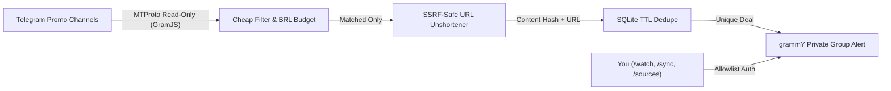

<p align="center">
  
</p>

<h1 align="center">deal-sniper</h1>

<p align="center">
  <strong>Event-driven Telegram deal radar &amp; price-budget sniper — zero retail scraping, zero proxies, zero exposed ports.</strong>
</p>

<p align="center">
  <a href="https://www.typescriptlang.org/"></a>
  <a href="https://nodejs.org/"></a>
  <a href="https://www.sqlite.org/"></a>
  <a href="https://github.com/luizGDpulz/deal-sniper/pkgs/container/deal-sniper"></a>
  <a href="LICENSE"></a>
</p>

---

## Overview & Architecture

Traditional 24/7 price monitors poll e-commerce pages directly, burning residential proxies and headless browser RAM fighting Cloudflare, Akamai, and HTML layout changes.

**deal-sniper** flips the model to an **Event-Driven / Push pipeline** inside a single, ultra-lean Node.js + TypeScript process:



1. **Passive Ingestion (`GramJS`):** Listens in real time to curated Telegram deal channels (or a single Telegram Chat Folder like `Promos`), outsourcing store monitoring to deal curators.
2. **Cheap Deterministic Funnel:** Matches keywords, regex, and negative blacklists, then parses Brazilian currency (`R$ 1.899,90 no Pix` vs. `10x de R$ 239,90`) and coupons **before** touching any network URL.
3. **SSRF-Safe Unshortener:** Resolves shortened affiliate URLs (`amzn.to`, `mercadolivre.com/sec/...`) only for matched offers, stripping tracking noise while validating every DNS/IP hop.
4. **Zero-Native SQLite (`node:sqlite` + Drizzle ORM):** Built directly on Node 24's native `node:sqlite` (`WAL` mode) — zero C++ native addons, instant multi-arch builds, single-file backup.
5. **Private Control Plane (`grammY`):** Topic-aware bot in your private group for managing watch rules, blacklists, and channels.

---

## Security & Hardening

Designed for self-hosting with a minimal attack surface:

- **Zero Exposed Inbound Ports:** Both GramJS (MTProto) and grammY (Bot API long polling) operate **100% outbound-only**. No HTTP port, no `ports:`, no reverse proxy exposure required.
- **Strict Allowlist Middleware:** Commands from any `userId` outside `ALLOWED_USER_IDS` (or outside `ALLOWED_CHAT_ID` when configured) are **silently dropped** to prevent bot probing.
- **SSRF-Safe Redirect Resolution:** Blocks `localhost`, `.internal`, embedded URL credentials, IPv4 private/reserved ranges (`10/8`, `172.16/12`, `192.168/16`, `100.64/10` CGNAT, `169.254/16` cloud metadata), IPv6 ULA/link-local, and IPv4-mapped IPv6 (`::ffff:127.0.0.1`) across every redirect hop.
- **100% Read-Only MTProto Listener:** Never sends messages, joins channels, or scrapes member lists via your user session.
- **Hardened Container:** Multi-stage Alpine image running as non-root `USER node`, `read_only: true` root filesystem, `cap_drop: [ALL]`, `no-new-privileges:true`, and `noexec` `/tmp` tmpfs.

---

## Bot Commands

Works seamlessly inside regular private chats or **Telegram Supergroups with Topics (Forum Mode)**:

| Command | Description | Example |
| :--- | :--- | :--- |
| `/watch <name> \| <keywords> \| [budget]` | Create a price watch rule in the current chat/topic | `/watch Monitor OLED \| monitor, oled \| 3500` |
| `/list` | List active watch rules and BRL ceilings | `/list` |
| `/unwatch <id>` | Soft-delete a watch rule by ID | `/unwatch 1` |
| `/ignore <term>` | Add a global negative keyword (e.g. accessories, used) | `/ignore suporte` |
| `/unignore <id>` | Remove a negative keyword rule | `/unignore 2` |
| `/sources` | List synced Telegram channels and their active state | `/sources` |
| `/toggle <id>` | Enable or pause monitoring for a specific channel | `/toggle 4` |
| `/sync [folder]` | Sync channels from Telegram (optionally by folder name) | `/sync Promos` |
| `/status` | Uptime, MTProto link state, active counts, 24h metrics | `/status` |

---

## Quick Start (Self-Hosting via GHCR)

### 1. Gather Credentials

1. **Bot Token (`BOT_TOKEN`):** Create a bot via [@BotFather](https://t.me/BotFather) and disable Group Privacy if using commands in a private supergroup (`/setprivacy` → `Disable`).
2. **Your User ID (`ALLOWED_USER_IDS`):** Fetch your numeric Telegram ID via [@userinfobot](https://t.me/userinfobot).
3. **MTProto Keys (`TELEGRAM_API_ID` & `TELEGRAM_API_HASH`):** Register a client app at [my.telegram.org](https://my.telegram.org).

### 2. Prepare Environment & Generate `TELEGRAM_SESSION`

```bash
mkdir -p deal-sniper/data
cd deal-sniper
curl -fsSLO https://raw.githubusercontent.com/luizGDpulz/deal-sniper/main/.env.example
curl -fsSLO https://raw.githubusercontent.com/luizGDpulz/deal-sniper/main/compose.yml
cp .env.example .env
# Edit .env with BOT_TOKEN, ALLOWED_USER_IDS, TELEGRAM_API_ID, TELEGRAM_API_HASH
```

Run the one-time interactive MTProto login to generate `TELEGRAM_SESSION`:

```bash
docker run --rm -it --env-file .env ghcr.io/luizgdpulz/deal-sniper:latest node dist/scripts/auth-session.js
```

Paste the printed `TELEGRAM_SESSION` string into `.env` (keep `.env` `chmod 600 .env`).

### 3. Deploy Hardened Container

Ensure the `./data` folder is owned by UID `1000` (`node` user inside Alpine) and start the stack:

```bash
sudo chown -R 1000:1000 ./data
chmod 600 .env
docker compose pull
docker compose up -d
```

Check logs:

```bash
docker compose logs -f deal-sniper
```

---

## Local Development

```bash
pnpm install
cp .env.example .env
pnpm run auth        # Generate TELEGRAM_SESSION once
pnpm test            # Run Vitest unit & SQLite integration tests
pnpm run typecheck   # Strict TypeScript check
pnpm run dev         # Watch mode with tsx
```

---

## Tech Stack

- **Language & Runtime:** TypeScript 5.9 + Node.js 24 LTS (`pnpm`)
- **MTProto & Bot:** `telegram` (GramJS) + `grammY`
- **Database:** Native `node:sqlite` (`WAL`) + `drizzle-orm` (with Soft Delete)
- **Validation & Testing:** `zod` + `vitest`
- **Delivery:** Multi-arch GHCR (`linux/amd64`, `linux/arm64`) via GitHub Actions

## License

[MIT](LICENSE) © 2026 [Luiz Gustavo Dias Pulz](https://github.com/luizGDpulz)
